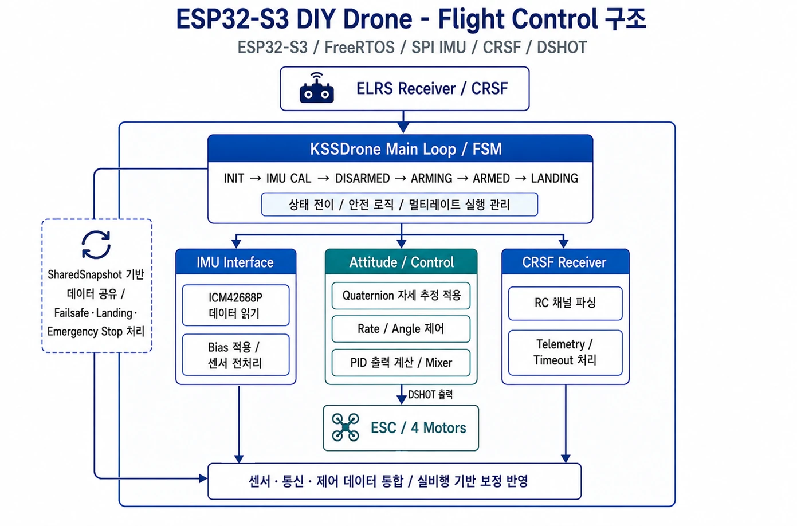
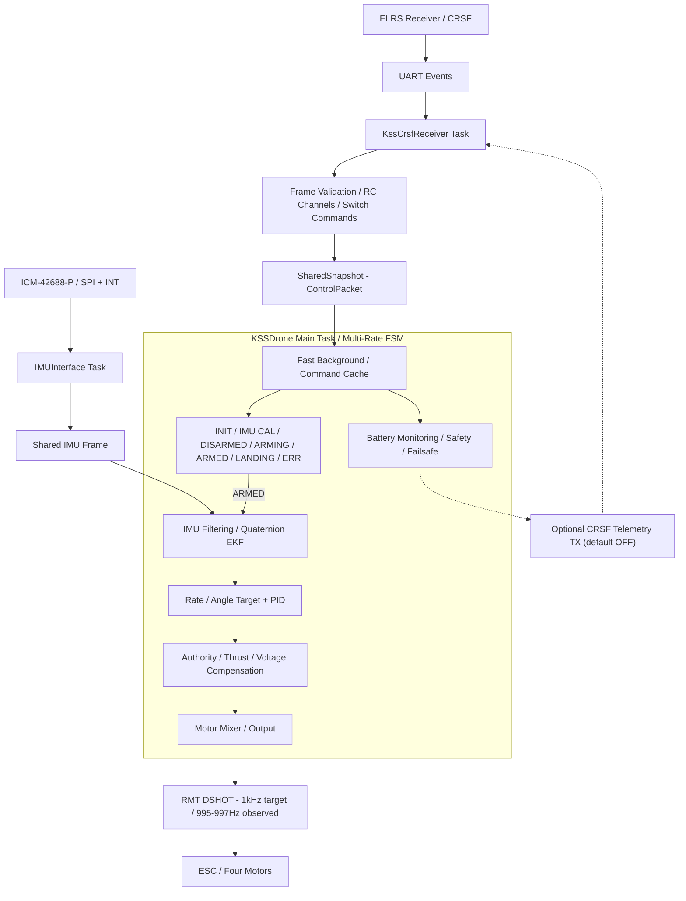
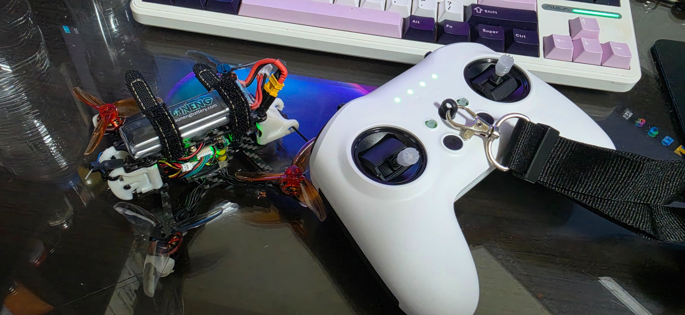
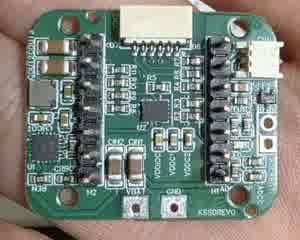
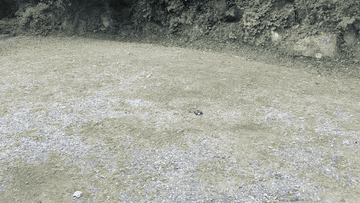

# ESP32-S3 Drone Firmware — Rev 1.3-c

> Seeed Studio XIAO ESP32-S3 기반 2.5인치 쿼드콥터 비행 제어 펌웨어입니다. Rev 1.3-c는 기존 FSM과 제어 기능을 그대로 유지하면서, 각 기능의 실행 주기를 맞추기 위한 추가 실행 스케줄을 적용한 버전입니다. ELRS/CRSF 전환 및 야외 비행 검증은 Rev 1.3-b에서 수행했습니다.

[English](#english)

## 프로젝트 개요

이 프로젝트는 센서 입력, 자세 추정, PID 제어, 상태 머신, 추력 보정, 모터 출력을 하나의 ESP32-S3 비행 제어기에 통합한 개인 제작 드론 펌웨어입니다.

Rev 1.3-b에서는 RadioMaster/ELRS/CRSF 조종 링크를 도입했습니다. Rev 1.3-c는 기존 FSM·제어 알고리즘을 유지한 채 20ms/40-slot 스케줄로 IMU·EKF·PID·Motor 실행 주기를 정렬합니다. CRSF RC 채널 수신, 명령 반복 전송, 통신 timeout 및 스위치 edge 검출을 실제 제어 파이프라인에 통합했습니다. 배터리·비행 모드 telemetry 송신 구현은 확장용으로 보존하되 현재 `test` 설정에서는 기본 비활성화합니다.

## 현재 상태

| 항목 | 상태 |
| --- | --- |
| 현재 버전 | **Rev 1.3-c — Multi-rate execution scheduling** |
| 빌드 및 기본 기능 | 확인 완료 |
| RadioMaster/ELRS 채널 동작 | 확인 완료 |
| 목표 main control rate | 2 kHz |
| ARMED 상태 실측 주기 (`test`, 2026-11) | 약 1,959 Hz (TX·정밀 계측 OFF) |
| Motor/DSHOT 출력 | 목표 1 kHz / 별도 실측 **995–997 Hz** |
| 실제 야외 비행 | **검증 완료** |
| 장거리 통신 범위 | 추가 검증 필요 |

## 개발 환경

| 항목 | 내용 |
| --- | --- |
| Flight controller | Seeed Studio XIAO ESP32-S3 |
| Framework | ESP-IDF 6.0 |
| RTOS | FreeRTOS |
| IMU | ICM-42688-P, SPI, 8 kHz ODR |
| Control link | ELRS UART / CRSF |
| Motor protocol | RMT 기반 DSHOT |
| Flight modes | RATE/ACRO, ANGLE/SELF-LEVEL |
| Language | C / C++ |

## 프로그램 구조

Rev 1.3-c는 기존 **CRSF 수신 Task**, **IMU 취득 Task**, **비행 제어 Main Task**를 분리한 FreeRTOS 구조입니다. 통신·센서 데이터를 공유하고, 메인 FSM에서 안전 상태와 멀티레이트 제어 파이프라인을 관리합니다.

### 비행 제어 구조도

  

### Mermaid 프로그램 구성도

- **입력 및 공유:** CRSF 채널·명령을 수신하여 SharedSnapshot에 저장하며, IMU 데이터는 별도 센서 Task에서 취득합니다.
- **FSM 및 안전:** 비행 제어 Main Task가 명령·통신 timeout·failsafe·landing·emergency stop을 처리합니다.
- **자세 제어:** quaternion 기반 자세 추정, Rate/Angle 제어, PID, 추력 보정 및 4모터 믹싱을 실행합니다.
- **출력 및 Telemetry:** RMT 기반 DSHOT으로 ESC를 제어합니다. CRSF 배터리·비행 모드 TX 구현은 보존하지만 `test` 브랜치에서는 기본 비활성화합니다.

## 하드웨어 및 비행 테스트 미디어

### 완성 기체와 조종기

  

### 커스텀 Carrier Board

  

### Rev 1.3-b 야외 비행 테스트

실제 야외 비행은 `ANGLE_SELF_LEVEL` 모드에서 진행했습니다. 이 테스트에서 이륙, 상승, 기본 자세 제어, 완만한 하강과 ELRS/CRSF 조종 링크의 정상 동작을 확인했습니다.

급하강에서는 일시적인 yaw disturbance가 재현되었으며, 일반 상승·호버·완만한 하강에서는 지속적인 yaw 불안정이나 자세 발산이 관찰되지 않았습니다. 현재 기체에는 Optical Flow/ToF가 없으므로 위치 유지와 절대 고도 유지는 포함하지 않습니다.

**외부 촬영**

  

**FPV 카메라**

  

## CRSF 구현 범위

| 방향 | Frame | 용도 |
| --- | --- | --- |
| RX | `0x16 RC Channels Packed` | 16채널 조종 입력 수신 및 정규화 |
| RX | `0x14 Link Statistics` | 링크 상태 수신 |
| TX | `0x08 Battery Sensor` | 필터링된 배터리 전압 및 상태 송신 |
| TX | `0x21 Flight Mode` | 현재 비행 모드 송신 |

GPS frame(`0x02`)은 현재 구현 범위에서 제외했습니다. Link Statistics는 수신할 수 있지만 아직 비행 제어 판단에는 사용하지 않습니다. TX는 향후 기능으로 보존하며 기본 OFF입니다. 활성화하더라도 best-effort 경로로 처리합니다.

## Rev 1.3-b에서 유지한 기능

### ELRS/CRSF 입력 확정

- ESP-NOW 기반 전용 조종기를 ELRS UART/CRSF 링크로 교체
- CRSF 16채널 decoding 및 stick 값 정규화
- 최신 정상 `ControlPacket` timestamp를 이용한 통신 timeout 판정
- critical section 기반 shared snapshot으로 통신 task와 비행 제어 task 사이의 데이터 tearing 방지
- 모든 정상 RC frame마다 증가하는 control sequence를 이용해 새 입력과 반복 snapshot 구분

### Stick 및 AUX switch 동작

| 입력 | 동작 |
| --- | --- |
| Roll / Pitch / Yaw | CRSF raw 값을 `-1.0 ~ 1.0`으로 정규화 |
| Throttle | 절대 위치형 `0.0 ~ 1.0` 입력 |
| SA | 누르는 동안 PREARM 활성 |
| SE | `LOW → HIGH`: ARM 요청, `HIGH → LOW`: DISARM 요청 |
| SB | `LOW → MID/HIGH`: SOFT LANDING 1회 요청 |
| SC LOW | `RATE_ACRO` (`mode 0`) |
| SC MID/HIGH | `ANGLE_SELF_LEVEL` (`mode 1`) |
| SD | 상승 edge에서 level/gyro bias calibration 요청 |

SB의 MID와 HIGH는 동일한 소프트 랜딩 활성 상태로 처리하므로 `MID ↔ HIGH` 이동에서는 추가 명령이 발생하지 않습니다. SC도 MID와 HIGH를 동일한 `ANGLE_SELF_LEVEL` 모드로 처리합니다.

### ARM 및 초기화 안전 조건

- 첫 정상 RC frame에서는 현재 switch 상태만 저장하여 전원 투입 직후의 의도하지 않은 명령 발생 방지
- 기동 후 SE의 LOW 상태를 한 번 확인한 뒤 `LOW → HIGH` edge에서만 ARM 허용
- ARM 시 SA PREARM 활성 필요
- ARM 시 throttle 최저 범위 확인
- SB SOFT LANDING이 비활성 상태일 때만 ARM 허용
- SE `HIGH → LOW` edge의 DISARM 요청을 다른 일반 명령보다 우선 처리
- 공중 및 LANDING 상태의 일반 DISARM 허용 여부는 FC 상태 머신에서 최종 판단
- 최초 SC 위치는 FC 비행 모드에 동기화

소프트 랜딩 후 FC가 DISARMED가 되어도 SE는 물리적으로 HIGH에 남아 있을 수 있습니다. 재ARM하려면 SE를 LOW로 내려 입력을 해제한 뒤, PREARM 조건을 만족하고 다시 HIGH로 올려야 합니다.

### 명령 전달 및 telemetry

- 새 명령을 동일한 `cmd_seq`와 `cmd_flags`로 5회 반복 전송
- FC는 `cmd_seq`로 동일 명령의 반복 frame을 한 번만 실행
- Battery Sensor와 Flight Mode TX 구현을 보존하며 현재 기본 OFF (활성화 시 기존 주기 사용)
- Telemetry 활성화 시 송신 실패는 비행 제어 상태를 변경하지 않음
- 필터링된 배터리 전압과 상태는 내부에서 유지하고, Telemetry 활성화 시 송신 데이터에도 반영

### 비행 제어 유지 및 보완

- Rev 1.2의 multi-rate 제어 파이프라인 유지
- quaternion 기반 gyro predict와 조건부 accelerometer correction 유지
- RATE/ACRO 및 ANGLE/SELF-LEVEL 모드 지원
- 저 throttle authority scaling, yaw priority/hover boost 및 TPA 적용
- thrust curve, 배터리 전압 보상, high-throttle 제한 및 수직 속도 damping 적용
- emergency stop 명령 수신 시 상태와 관계없이 모터 출력을 즉시 차단하는 FC 안전 경로 유지

## 현재 ARMED 파이프라인

1. **Command / Safety / Flight state** — CRSF snapshot, timeout, ARM/DISARM, soft landing, mode, calibration, target 및 failsafe 처리
2. **Sensor / Estimation** — IMU filtering, quaternion predict, gated gravity correction, attitude/vertical state 및 tilt safety 처리
3. **Attitude control** — angle-to-rate 변환, rate PID, authority scaling, yaw priority/boost 및 TPA
4. **Thrust compensation** — thrust curve, battery voltage compensation, high-throttle limit 및 vertical-speed damping
5. **Mixer / Motor output** — quad mixing, normalization, DSHOT 변환 및 RMT 출력

## Multi-rate 실행 구조

| 처리 항목 | 목표 또는 설정 |
| --- | ---: |
| Main control / IMU fast processing / rate PID | 2 kHz target |
| Motor / DSHOT output | 1kHz target / separately measured 995–997Hz |
| Safety 및 command background jobs | fast periodic path |
| Battery monitoring | 20 Hz |
| CRSF telemetry TX | 기본 OFF (`ENABLE_CRSF_TELEMETRY=0`) |
| Telemetry 활성화 시 | 기존 10 Hz 목표 송신 스케줄 |

세부 추정·보상 항목은 계산 비용과 필요한 응답 속도에 따라 main loop의 분주 주기로 실행합니다.

## Rev 1.3-c — 기능별 실행 주기 정렬과 2kHz 스케줄 검증 (2026-11-18)

**Rev 1.3-b와 Rev 1.3-c의 핵심 차이는 기존 기능의 실행 주기를 맞추는 추가 스케줄입니다.** 기존 FSM과 제어 알고리즘은 변경하지 않고 ARMED 상태의 실행 시점을 20ms/40-slot로 배분합니다.

**Rev 1.3-c 기능별 실행 스케줄 목표 (기존 FSM 유지)**

| 기능 | 목표 주기 |
| --- | ---: |
| MainLoop / IMU / Rate PID | 2,000 Hz |
| Motor / DSHOT | **1,000 Hz 목표 / 별도 실측 995–997 Hz** |
| EKF / Failsafe / Tilt safety | 500 Hz |
| Airborne / Slow compensation | 250 Hz |
| Command target | 200 Hz (20ms 내 4회, 4/6ms 간격) |
| Output compensation | 100 Hz |

이는 추가 스케줄의 **설정 목표**이며 모든 개별 Deadline 충족을 보장하지는 않습니다. 아래 비교 로그의 Motor 약 974~980Hz는 해당 로그의 루프 기반 출력 카운트이며, 별도로 확인한 995~997Hz DSHOT 실측값과 측정 조건을 구분합니다.

- `FastBackgroundJobs()`는 매 MainLoop(목표 2kHz)마다 ELRS/CRSF `UpdateCommandCache()`와 `HandleCommandEvents()`를 실행합니다. 실제 RF 패킷 도착 주기는 별개입니다.
- `ProcessSlowBackground()`는 약 10ms마다 배터리·LED·선택형 Telemetry 송신을 점검합니다. 잔여 시간 승인과 최대 대기시간 강제 실행 정책을 사용하며, 강제 작업은 500µs deadline을 초과할 수 있습니다.
- **배터리 Fail-safe 복원:** 8회 ADC 샘플링 `BatteryMonitor::Update()`를 유지하고, ARMED의 `ArmedFailsafeFast()`에서 `BatteryState::CRITICAL` 시 `LANDING(FAILSAFE)`로 전환합니다. CRSF 송신과 무관한 안전 경로입니다.
- **Telemetry 선택 기능:** 현재 조종기는 Telemetry를 소비하지 않으므로 `ENABLE_CRSF_TELEMETRY=0`을 기본값으로 합니다. TX 구현은 보존하고, 비활성 시 송신 스케줄과 불필요한 BG 선점도 제외합니다. 수신과 안전 이벤트 경로는 그대로 유지합니다.
- **진단 기본값:** `ENABLE_ARMED_SLOT_TIMING_PROFILE=0`. 매 반복 정밀 계측은 주파수에 영향을 주므로 비행 기본 설정에서 끕니다. 기존 `KSS loop`·`GAP_CAUSE` 1Hz RAM 버퍼링은 유지합니다.

| ARMED 테스트 조건 | Main Loop | Motor |
| --- | ---: | ---: |
| Battery ON / Slot 계측 ON | 약 1,946 Hz | 약 973 Hz |
| Battery OFF / Slot 계측 ON | 약 1,968 Hz | 약 984 Hz |
| Battery ON / Slot+BG 계측 ON | 약 1,752 Hz | 약 876 Hz |
| Battery OFF / Slot+BG 계측 ON | 약 1,864 Hz | 약 932 Hz |
| Battery ON / 정밀 계측 OFF / Telemetry TX ON | 약 1,949 Hz | 약 974 Hz |
| **Battery ON / 정밀 계측 OFF / Telemetry TX OFF** | **약 1,959 Hz** | **약 980 Hz** |

마지막 두 단일 비행 로그에서 `sch_miss`는 약 1,163회/초에서 941회/초로 감소했습니다. 원인 전체를 TX 비활성화로 확정할 수는 없습니다. 잔여 시간으로 승인한 BG 작업은 계측 표본에서 500µs를 초과하지 않았지만 최대 지연에 의한 강제 BG 작업은 종종 초과했습니다. 정밀 계측 자체가 타이밍을 변경했으므로 실제 비계측 실행 시간과 혼동하지 않아야 합니다.

**검증 상태:** 위 성능 수치는 코드 정리 이전 로그입니다. Rev 1.3-c 변경 후 빌드·하드웨어·비행 재검증이 필요하며, 특히 복원된 배터리 CRITICAL Fail-safe는 별도 안전 테스트가 필요합니다. 아래 과거 수치는 초기 Rev 1.3-b 조건의 측정값입니다.

## 과거 측정 결과 (초기 Rev 1.3-b 조건)

| Control link | ARMED 상태 main loop |
| --- | ---: |
| ESP-NOW | 약 1,880–1,900 Hz |
| ELRS/CRSF | 약 1,850–1,870 Hz |

- CRSF 전환 후 약 30 Hz, 약 1.6%의 추가 처리 비용이 확인되었습니다.
- 당시 목표 2 kHz 대비 평균 loop time은 약 535–541 μs였습니다.
- 통신 변경 자체의 영향은 작으며, 2 kHz 미달의 주원인은 ESP32-S3에서 센서 처리, 추정, 제어, 상태 머신과 통신을 함께 수행하는 전체 연산 부하입니다.
- 이 수치는 초기 테스트 조건의 참고값이며, 최신 `test` 측정 기준은 위 표에 별도로 기록합니다.

## 알려진 한계 및 향후 개선

### 1. 동시 command event 보존

현재 한 RC frame에서 여러 switch edge가 동시에 발생하면 우선순위에 따라 하나의 명령만 단일 command slot에 저장합니다. 선택된 명령은 5회 반복되지만, 같은 frame에서 선택되지 않은 event는 이전 switch 상태가 갱신되면서 유실될 수 있습니다.

향후 개선 방향:

- 한 frame에서 발생한 event를 bit flag로 모두 저장
- 안전 우선순위에 따라 event를 하나씩 선택
- 선택한 각 명령을 동일한 sequence로 5회 반복 전송
- 반복 완료 후 다음 pending event 처리
- DISARM 또는 SOFT LANDING 발생 시 대기 중인 ARM 등 상충 event 취소
- ARM은 실제 전송 시점에도 PREARM, throttle 및 landing 조건 재확인

### 2. CRSF 오류 frame의 조기 판별

현재 parser는 sync byte와 length 범위를 먼저 검사하지만, 범위 안의 잘못된 length가 들어오면 선언된 길이만큼 수신한 뒤 CRC에서 오류를 확인합니다. 이 과정에서 다음 정상 frame의 일부를 손상된 frame에 포함할 수 있습니다.

ELRS의 빠른 통신 주기 때문에 실제 복구 지연은 비교적 짧지만, 다음 조건을 추가하여 더 빠른 오류 판별과 재동기화를 적용할 수 있습니다.

- frame type별 허용 length 검사
- 지원하는 address 및 frame type 선행 검사
- inter-byte timeout으로 불완전 frame 폐기
- CRC 실패 후 다음 sync 후보 탐색
- 오류 및 재동기화 통계 기록

### 3. ESP32-S3 timing margin

- 최신 `test` 측정에서 약 1,959 Hz가 관측됐지만 개별 500µs deadline miss는 계속 발생합니다.
- blocking RMT DSHOT 출력은 여전히 큰 시간 제약입니다.
- 4 kHz control loop는 현재 구조에서 현실적으로 어렵습니다.
- 확실한 2 kHz 이상 주기와 추가 센서 처리는 STM32 기반 Rev2에서 진행할 예정입니다.

### 4. 위치 및 고도 유지

현재 기체에는 Optical Flow와 ToF가 없어 XY 위치 유지와 절대 고도 유지 기능이 없습니다. 해당 기능은 센서 신뢰도, 바닥 무늬, 조명, 반사율 및 연산 자원을 함께 고려해야 하므로 Rev1.3-c 범위에서 제외했습니다.

## 다음 단계 — Rev2

Rev1.3-c는 ESP32-S3 기반 Rev1.x의 실행 주기 정렬·검증 단계입니다. 다음 하드웨어 revision은 STM32 기반으로 전환하며 다음 항목을 목표로 합니다.

- 2 kHz 이상 비행 제어 주기의 안정적 확보
- non-blocking motor output 및 timing margin 개선
- command event bit queue와 안전 취소 정책 적용
- CRSF frame 조기 검증 및 timeout 기반 재동기화
- OSD용 추가 UART 확보
- Optical Flow/ToF 등 추가 센서 확장성 검토

---

# ESP32-S3 Drone Firmware — Rev 1.3-c

> Flight-control firmware for a 2.5-inch quadcopter based on the Seeed Studio XIAO ESP32-S3. Rev 1.3-c adds execution scheduling to align the rates of the existing flight-control functions without redesigning the FSM. ELRS/CRSF integration and outdoor flight validation were established in Rev 1.3-b.

## Overview

The firmware integrates sensor acquisition, attitude estimation, PID control, a flight-state machine, thrust compensation, and motor output on a single ESP32-S3 flight controller.

Rev 1.3-b migrated the control link to RadioMaster/ELRS/CRSF. Rev 1.3-c retains the existing FSM/control algorithms while adding a 20ms/40-slot scheduler to align their execution rates. It integrates CRSF RC input, repeated command delivery, communication timeout handling, and switch-edge detection. Battery/flight-mode telemetry TX remains implemented for future use but is disabled by default in the current `test` configuration.

## Current Status

| Item | Status |
| --- | --- |
| Current revision | **Rev 1.3-c — Multi-rate execution scheduling** |
| Build and basic functions | Verified |
| RadioMaster/ELRS channel behavior | Verified |
| Target main control rate | 2 kHz |
| Measured ARMED rate (`test`, Nov 2026) | Approximately 1,959 Hz (TX/detailed tracing OFF) |
| Motor/DSHOT output | 1 kHz target / **995–997 Hz** separately measured |
| Outdoor flight test | **Verified** |
| Long-range link test | Further validation required |

## Development Environment

| Item | Details |
| --- | --- |
| Flight controller | Seeed Studio XIAO ESP32-S3 |
| Framework | ESP-IDF 6.0 |
| RTOS | FreeRTOS |
| IMU | ICM-42688-P over SPI, 8 kHz ODR |
| Control link | ELRS UART / CRSF |
| Motor protocol | RMT-based DSHOT |
| Flight modes | RATE/ACRO and ANGLE/SELF-LEVEL |
| Languages | C / C++ |

## Program Structure

Rev 1.3-c retains the **CRSF receiver task**, **IMU acquisition task**, and **main flight-control task** under FreeRTOS. Communication and sensor data feed the main FSM, which manages safety conditions and the multi-rate flight-control pipeline.

### Flight-Control Architecture

  

### Mermaid Software Architecture

- **Input and data sharing:** The CRSF task receives RC channels and commands through SharedSnapshot while a separate IMU task acquires sensor data.
- **FSM and safety:** The main flight-control task handles commands, communication timeout, failsafe, landing, and emergency stop.
- **Attitude control:** Quaternion-based estimation, Rate/Angle control, PID, thrust compensation, and four-motor mixing form the flight-control pipeline.
- **Output and telemetry:** RMT-based DSHOT drives the ESCs. CRSF battery/flight-mode TX is retained but default-disabled on `test`.

## Hardware and Flight-Test Media

### Complete Aircraft and Controller

  

### Custom Carrier Board

  

### Rev 1.3-b Outdoor Flight Test

The outdoor validation flight was performed in `ANGLE_SELF_LEVEL` mode. The test verified takeoff, climb, basic attitude control, gentle descent, and normal ELRS/CRSF control-link operation.

A transient yaw disturbance was reproducible during rapid descent. No sustained yaw instability or attitude divergence was observed during normal climb, hover, or gentle descent. The current aircraft has no Optical Flow/ToF sensors, so position hold and absolute altitude hold are outside this test scope.

**External camera**

  

**FPV 카메라**

  

## CRSF Scope

| Direction | Frame | Purpose |
| --- | --- | --- |
| RX | `0x16 RC Channels Packed` | Receive and normalize 16 RC channels |
| RX | `0x14 Link Statistics` | Receive link status |
| TX | `0x08 Battery Sensor` | Transmit filtered battery voltage and state |
| TX | `0x21 Flight Mode` | Transmit the current flight mode |

The GPS frame (`0x02`) is intentionally excluded. Link Statistics can be received but are not yet used for flight-control decisions. TX is optional and disabled by default; when enabled, it is best-effort.

## Features Retained from Rev 1.3-b

### ELRS/CRSF input

- Replaced the custom ESP-NOW controller with an ELRS UART/CRSF link
- Added CRSF 16-channel decoding and stick normalization
- Detects communication timeout from the timestamp of the latest valid `ControlPacket`
- Uses critical-section-protected shared snapshots to prevent data tearing between communication and flight-control tasks
- Uses an incrementing control sequence to distinguish new RC input from repeated snapshot reads

### Stick and AUX switch mapping

| Input | Behavior |
| --- | --- |
| Roll / Pitch / Yaw | Normalize CRSF raw values to `-1.0 ... 1.0` |
| Throttle | Absolute-position input mapped to `0.0 ... 1.0` |
| SA | PREARM while held |
| SE | `LOW → HIGH`: ARM request; `HIGH → LOW`: DISARM request |
| SB | `LOW → MID/HIGH`: one SOFT LANDING request |
| SC LOW | `RATE_ACRO` (`mode 0`) |
| SC MID/HIGH | `ANGLE_SELF_LEVEL` (`mode 1`) |
| SD | Rising edge requests level/gyro-bias calibration |

SB MID and HIGH are treated as the same landing-active state, so moving between them does not generate another command. SC MID and HIGH both select `ANGLE_SELF_LEVEL`.

### Arming and startup safety

- The first valid RC frame captures switch states without generating unintended startup commands
- Arming requires observing SE LOW at least once before a `LOW → HIGH` edge
- SA PREARM must be active
- Throttle must be within the minimum range
- SB SOFT LANDING must be inactive
- A `HIGH → LOW` DISARM request has priority over normal commands
- The FC state machine makes the final decision on ordinary DISARM requests while airborne or landing
- The initial SC position is synchronized to the FC flight mode

After a soft landing, the FC may be DISARMED while SE remains physically HIGH. Re-arming requires returning SE to LOW, satisfying the PREARM conditions, and then moving it to HIGH again.

### Command delivery and telemetry

- Repeats each new command five times with the same `cmd_seq` and `cmd_flags`
- The FC executes repeated frames only once by de-duplicating `cmd_seq`
- Retains Battery Sensor / Flight Mode telemetry TX for future use; default OFF
- When telemetry TX is enabled, transmission failures do not alter the flight state
- Maintains filtered battery data locally and reports it over CRSF only when telemetry TX is enabled

## ARMED Pipeline

1. **Command / Safety / Flight state** — CRSF snapshot, timeout, ARM/DISARM, soft landing, mode, calibration, target, and failsafe handling
2. **Sensor / Estimation** — IMU filtering, quaternion prediction, gated gravity correction, attitude/vertical state, and tilt safety
3. **Attitude control** — angle-to-rate conversion, rate PID, authority scaling, yaw priority/boost, and TPA
4. **Thrust compensation** — thrust curve, battery-voltage compensation, high-throttle limiting, and vertical-speed damping
5. **Mixer / Motor output** — quad mixing, normalization, DSHOT conversion, and RMT output

## Rev 1.3-c — Per-Function Rate Alignment and 2kHz Scheduling Validation (2026-11-18)

**The main difference between Rev 1.3-b and Rev 1.3-c is the added execution schedule to align existing function rates.** The FSM and underlying algorithms are unchanged; ARMED work is assigned across 20ms/40 slots.

**Rev 1.3-c nominal per-function rates (existing FSM unchanged)**

| Function | Scheduled target |
| --- | ---: |
| MainLoop / IMU / Rate PID | 2,000 Hz |
| Motor / DSHOT | **1,000 Hz target / 995–997 Hz separately measured** |
| EKF / failsafe / tilt safety | 500 Hz |
| Airborne / slow compensation | 250 Hz |
| Command target | 200 Hz (four executions/20ms; 4/6ms gaps) |
| Output compensation | 100 Hz |

These are scheduled targets, not hard-deadline guarantees. The ~974–980Hz motor counts in the comparison logs below and the separately observed 995–997Hz DSHOT frequency are from different measurement conditions.

- `FastBackgroundJobs()` runs `UpdateCommandCache()` and `HandleCommandEvents()` every main-loop iteration (2kHz target). The over-the-air RF packet rate is independent of this polling rate.
- `ProcessSlowBackground()` checks battery, LED, and optional telemetry TX about every 10ms. Admission uses remaining slot time and bounded deferral; forced jobs may violate a 500µs deadline.
- **Restored battery fail-safe:** Keep the eight-ADC-sample `BatteryMonitor::Update()`. In ARMED, `ArmedFailsafeFast()` enters `LANDING(FAILSAFE)` when `BatteryState::CRITICAL`. This safety path is independent of CRSF TX.
- **Optional TX:** `ENABLE_CRSF_TELEMETRY=0` disables unused transmission/scheduling by default, preserving the TX implementation. ELRS command RX and safety events remain enabled.
- **Diagnostics:** `ENABLE_ARMED_SLOT_TIMING_PROFILE=0` disables costly per-slot/BG tracing by default. 1Hz KSS loop/gap reports remain buffered during ARMED and printed after disarm.

| ARMED test configuration | Main Loop | Motor |
| --- | ---: | ---: |
| Battery ON / slot tracing ON | ~1,946 Hz | ~973 Hz |
| Battery OFF / slot tracing ON | ~1,968 Hz | ~984 Hz |
| Battery ON / slot+BG tracing ON | ~1,752 Hz | ~876 Hz |
| Battery OFF / slot+BG tracing ON | ~1,864 Hz | ~932 Hz |
| Battery ON / detailed tracing OFF / telemetry TX ON | ~1,949 Hz | ~974 Hz |
| **Battery ON / detailed tracing OFF / telemetry TX OFF** | **~1,959 Hz** | **~980 Hz** |

In the final two single-flight logs, `sch_miss` decreased from ~1,163/s to ~941/s. The comparison does not establish that TX removal alone caused the entire reduction. Slack-admitted BG samples did not exceed 500µs, while bounded-age forced BG jobs frequently did. The detailed tracing itself changed loop timing.

**Validation:** These measurements predate the code cleanup. Rev 1.3-c requires post-change build and hardware/flight validation, including a separate safe test for the restored battery-critical landing trigger. Historical figures below are from earlier Rev 1.3-b conditions.

## Historical Measurements (early Rev 1.3-b conditions)

| Control link | ARMED main loop |
| --- | ---: |
| ESP-NOW | Approximately 1,880–1,900 Hz |
| ELRS/CRSF | Approximately 1,850–1,870 Hz |

- The CRSF migration reduced the measured main-loop rate by roughly 30 Hz, or about 1.6%.
- The mean loop time in those earlier tests was approximately 535–541 μs against the 500 μs target.
- The control-link overhead is small; the main limitation is the total ESP32-S3 workload from sensing, estimation, control, state handling, and communication.
- These are historical results from earlier test conditions; the updated `test` measurement is shown above.

## Known Limitations and Planned Improvements

### Concurrent command events

The current implementation stores only one command from multiple switch edges detected in the same RC frame. The selected command is repeated five times, but lower-priority events can be lost after the previous switch states are updated.

The planned design captures every event as a bit flag, selects events by safety priority, repeats each selected command five times, and then processes the next pending event. Conflicting events such as a pending ARM after DISARM or SOFT LANDING will be cancelled, and ARM conditions will be revalidated when the command is transmitted.

### Early CRSF error detection

The parser validates the sync byte and length range immediately, but a corrupted length that remains within the legal range is detected only after the declared frame has been received and its CRC fails. This can consume part of the following valid frame.

Planned improvements include type-specific length checks, supported-address/type validation, an inter-byte timeout, CRC-failure resynchronization, and recovery statistics.

### ESP32-S3 timing margin

- Recent `test` logs show ~1,959 Hz with detailed tracing and telemetry TX disabled, but individual 500µs deadlines can still be missed.
- Blocking RMT DSHOT output is still a major timing constraint.
- A 4 kHz control loop is impractical with the current architecture.
- Stable 2 kHz-or-higher control and additional sensor processing are deferred to the STM32-based Rev2 design.

### Position and altitude hold

The current aircraft has no Optical Flow or ToF sensors, so XY position hold and absolute altitude hold are unavailable. These features are outside the Rev 1.3-c scope because they require joint validation of sensor reliability, floor texture, lighting, reflectivity, and processing resources.

## Next Stage — Rev2

Rev 1.3-c is the current execution-rate alignment and validation stage of the ESP32-S3-based Rev1.x platform. The STM32-based Rev2 design targets:

- Stable flight-control rates of 2 kHz or higher
- Non-blocking motor output and improved timing margin
- A bit-based pending-command queue with safety cancellation policies
- Early CRSF validation and timeout-based parser resynchronization
- An additional UART for OSD
- Expansion options for Optical Flow, ToF, and other sensors
